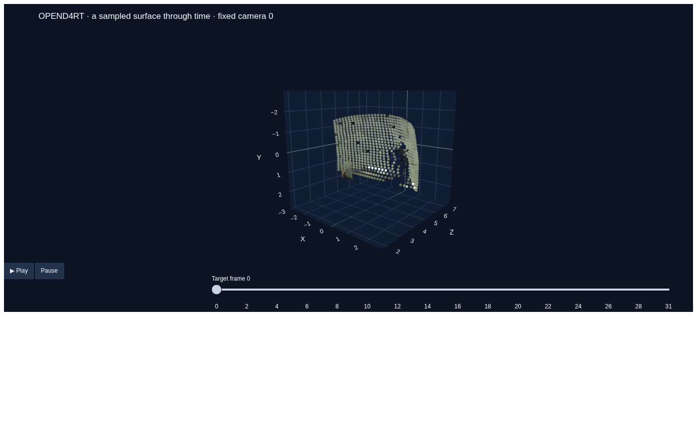

# D4RT presentation demo

A short notebook built around the requested interface:

```python
d = d4rt(video)
p = d.query(u, v, t_src, t_tgt, t_cam)
```

The notebooks contain saved outputs, and the HTML presentations work offline after
downloading them. To run inference from a fresh clone, follow the GPU setup below.
In the already prepared local workspace, launch directly:

```bash
.venv/bin/python -m jupyterlab D4RT_demo.ipynb
```

The notebook already contains saved real predictions. For the talk, you can also
open `artifacts/D4RT_demo.html` or `artifacts/opend4rt_4d_scene.html` directly.



Validated on an NVIDIA RTX PRO 5000 Blackwell with PyTorch 2.11: one video encoding,
16,806 queries, finite saved geometry, nine passing tests, and offline player playback
verified in Chrome. Timings are specific to this machine and clip.

Open **[D4RT_demo.ipynb](D4RT_demo.ipynb)** for real OpenD4RT inference on the
`pstudio_mini/juggle_5` sequence recommended by the upstream project. It demonstrates
depth, sparse 3D tracks, fixed and moving camera references, backward queries, and
an interactive 4D surface. The main cells show the query API; configuration and
visualization live in `d4rt_demo/`.

**[D4RT_rehearsal.ipynb](D4RT_rehearsal.ipynb)** runs on CPU using a clearly labeled
analytic scene. Its saved outputs teach the interface; they are not model predictions.
`artifacts/D4RT_rehearsal.html` and `artifacts/illustration_4d_scene.html` work offline.

## Prepare the GPU environment

Use Python 3.11 or 3.12. OpenD4RT's upstream environment uses PyTorch 2.6/CUDA 12.4;
a newer PyTorch build matching your GPU also works with this adapter. Blackwell GPUs
need a compatible newer CUDA/PyTorch build, such as the installed PyTorch 2.11/CUDA 12.8.
Install PyTorch for your driver using the [official selector](https://pytorch.org/get-started/locally/).
Keep an existing working CUDA environment if you already have one.

```bash
python3.11 -m venv .venv
source .venv/bin/activate
python -m pip install --upgrade pip
# Install a GPU-compatible PyTorch build, then:
python -m pip install -r requirements.txt
python scripts/setup_demo.py --weights --example
python -m ipykernel install --user --name d4rt-demo --display-name "D4RT demo"
python -m jupyterlab D4RT_demo.ipynb
```

Select the **D4RT demo** kernel, then Run All. The source, checkpoint and example are
downloaded during setup, not by the presentation cells. The checkpoint is approximately
14 GB on disk; GPU memory depends on clip length, precision, and query chunk size.
The notebook uses FP32 for a clear query-independence demonstration. Set
`precision="auto"` for reduced-precision model weights with FP32 LayerNorms. A 40–48 GB
GPU is a comfortable target; smaller cards may require a shorter clip. No specific
throughput is promised. The notebook reports measured encoding and decoding times.

`juggle_5.npz` is a 6.8 MB WorldTrack file. Its JPEG frames alone are model input;
ground-truth depth, tracks and cameras are never passed to the model. The notebook
samples 32 frames at stride 2. All query time indices refer to this sampled clip,
not to the original file. WorldTrack playback uses an illustrative frame rate.
NPZ files use pickle for the trusted release's JPEG object arrays; use trusted files.

To use another upstream example:

```bash
python scripts/setup_demo.py --example softball_25
```

Then edit `VIDEO_PATH` and select source pixels in its first frame. Ordinary MP4 paths
also work with `load_video()`. If Google Drive temporarily blocks automated downloads,
download the NPZ from the [WorldTrack folder](https://drive.google.com/drive/folders/1-JW88ru30irMYyFab_4YBQbGbd9tKpXV)
and place it under `data/worldtrack/pstudio_mini/`.

## Save the presentation before the talk

```bash
python scripts/render_demo.py
```

This executes the real GPU notebook and writes:

- `artifacts/D4RT_demo_executed.ipynb`: saved real model outputs.
- `artifacts/D4RT_demo.html`: a portable HTML walkthrough.
- `artifacts/opend4rt_4d_scene.html`: a self-contained 3D player with a time slider.
- `artifacts/opend4rt_results.npz`: the shown predictions, frames and provenance.

The HTML player embeds Plotly's JavaScript, so rotation, playback and time scrubbing
work without a server, internet connection, or running model. The optional live query
explorer needs the notebook kernel. Trust the notebook to display its embedded HTML.

CPU rehearsal:

```bash
python scripts/render_demo.py --illustration
```

During the talk: show the two-line API, depth, tracks, camera-time comparison, then
rotate the 4D player and scrub time. The notebook includes short speaker cues. Use
the saved real player if you want predictable pacing; keep the live point explorer
for questions. To re-run GPU queries, retain the `d` object and its cached encoder
memory. Each new call to `d4rt(video)` encodes again.

## API conventions

`u,v` are normalized `[0,1]` coordinates. `t_src,t_tgt,t_cam` are integer frame indices
in `[0,T-1]`; out-of-range values are rejected rather than silently clamped.
Arguments follow NumPy broadcasting:

```python
# One point, all times, in frame-0 camera coordinates.
track = d.query(.62, .65, 0, np.arange(len(video)), 0)

# N points × T times.
tracks = d.query(uv[:, 0, None], uv[:, 1, None], 0, times, 0)

# A depth grid, camera Z from matched source/target/camera times.
U, V = pixel_grid(64, 40)
depth = d.query(U, V, 0, 0, 0).depth
```

Results contain `xyz`, `uv`, `visibility`, and `confidence_raw` NumPy arrays.
Visibility is sigmoid-transformed; confidence is deliberately left raw. For 2D
overlays use `t_cam=t_tgt`, matching upstream inference. Geometry is expressed in
the requested camera frame and the model's learned units; frame 0 is not an externally
calibrated world frame. The wrapper makes no metric-scale, consistency, quality or
causal forecasting guarantee. A first-frame grid only represents surfaces sampled
in that frame. Re-querying never falls back to synthetic output on failure.

## Verification and provenance

```bash
python -m unittest discover -s tests -v
```

Tests check broadcasting, input validation, visibility, camera coordinates, occlusion,
strict checkpoint loading, and encoder caching / chunk independence using a small
instance of the upstream architecture. Random test weights are never used in the demo.
Run `scripts/render_demo.py` to verify the complete released-checkpoint path.

Pinned source: `403290a6e7ea6262a1f20f8c02d5461cd7b6c9b3`.
Pinned checkpoint revision: `7099b1fc760475de3b7409acd6b63f801b015d07`.
The source, large weights, example data, and generated NumPy archives are ignored by Git.

- [D4RT paper and official project](https://d4rt-paper.github.io/).
- [OpenD4RT](https://github.com/Lijiaxin0111/Open-d4rt), an unofficial implementation,
  with its own released checkpoints and results; upstream code uses Apache 2.0.
- [Released weights and matching config](https://huggingface.co/Lijiaxin0111/OpenD4RT).
- Example data comes from the WorldTrack link in OpenD4RT's README and retains its
  original terms. The original D4RT authors do not provide or endorse this local wrapper.
